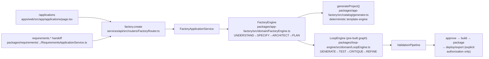

# VedMoulya — Canonical Mission Architecture

**Status:** CANONICAL. This is the single authoritative reference for how a
user goal becomes a Mission result in the active repository.
**Date (UTC):** 2026-10-13 · **Sprint:** 020B (documentation-only).
**Primary evidence:**
`docs/audits/2026-10-13-architecture-code-audit/FINAL-REPORT.md`
(Sprint 020A-1 architecture-to-code audit, HEAD `a124274b`).

No connections are invented here. Every edge carries the audit's evidence
classification: **VERIFIED** (active call/data flow with proof) · **PARTIAL**
(incomplete contract) · **STRUCTURAL ONLY** (types/registration/tests, no
runtime flow shown) · **DORMANT** (implemented, not on the active journey) ·
**MISSING** (no implementation found) · **UNKNOWN** (insufficient evidence).
A source file existing — or its unit tests passing — never alone proves a
runtime path is active.

## 1. Canonical Mission diagram

The active production spine. This replaces any factory → generator →
refinement picture as the Mission execution diagram.

```mermaid
flowchart TB
    subgraph UX["User experience — goal in, result out"]
        UI1["apps/web/src/app/page.tsx<br/>AskAIInput"]
        UI2["apps/web/src/components/AICompanion.tsx<br/>handleSend()"]
        UI3["apps/web/src/app/autonomous-builder/page.tsx<br/>useMissionStatus() poll"]
        UI4["MissionOverview / MissionResult / ObjectiveTimeline<br/>MissionActivity / LiveMissionView"]
        UI1 --> UI2
        UI2 -->|ACTION| GW["api.mission.createAndRun<br/>services/api/src/routers/MissionRouter.ts"]
        UI2 -->|ANSWER| GW2["api.ai.stream<br/>services/api/src/routers/AIRouter.ts"]
        GW4["MissionStatusView"] --> UI4
        UI3 --> GW4
    end

    subgraph ML["Mission lifecycle — single canonical autonomous lifecycle"]
        MS["MissionService<br/>services/api/src/services/MissionService.ts<br/>getRuntime() → createMissionRuntime()"]
        MR["MissionRuntime<br/>packages/mission-runtime/src/composition/MissionRuntime.ts"]
        MC["MissionControllerService<br/>packages/mission-controller/src/application/"]
        SEL["DevelopmentObjectiveSelector<br/>+ FsRepositoryInspector"]
        PLN["MissionPlanningAdapter → PlanningApplicationService<br/>+ PlannerService (AIOrchestrationPlannerPort)"]
        AGE["MissionPlanningAdapter / AgentExecutionAdapter<br/>→ AgentExecutionService<br/>packages/agent-execution/src/application/"]
    end

    subgraph AI["AI orchestration spine"]
        AOS["AIOrchestrationService<br/>packages/services/src/ai/AIOrchestrationService.ts"]
        DOM["AIDomainService + AIRequestFactory<br/>+ TokenEstimationService<br/>packages/ai/src/domain/services/"]
        ADV["ProviderRoutingAdvisor (frozen; shared by both paths)<br/>Mission spine wires deterministic ports:<br/>packages/mission-runtime/src/adapters/OrchestratorRoutingPorts.ts<br/>Ask/gateway path wires the enterprise ports:<br/>createProviderIntelligencePort (EI-002) + createExecutionStrategyPort (EI-004)<br/>+ createRagRetrievalPort (RAG) — services/api/src/infrastructure/RuntimePorts.ts"]
        ADPT["ProviderAdapter.execute()<br/>services/orchestrator/ (Gemini/OpenAI/DeepSeek/Ollama/mock)"]
        TOOL["ToolRuntime governed registry<br/>workspace/command tools, path-jailed"]
    end

    subgraph VP["Verification and persistence"]
        VER["verifyAgainstPolicy<br/>packages/agent-execution/src/domain/verification.ts"]
        CHK["Checkpoint stores<br/>InMemoryCheckpointStore / PostgresCheckpointStore"]
        PERS["PostgresMissionStores<br/>packages/mission-runtime/src/persistence/"]
    end

    subgraph ML2["Memory and learning — advisory"]
        MEM["ExecutionMemoryService.ingestRun()<br/>packages/execution-memory/src/application/"]
        EXP["experience-optimization<br/>(advisory only, never executes)"]
    end

    subgraph BR["Brain — reusable intelligence, NOT a Mission executor"]
        BRAIN["BrainApplicationService<br/>packages/brain/src/application/"]
        OPPRI["OutcomePriorityEngine<br/>packages/brain/src/domain/"]
        BRAIN --> OPPRI
    end

    UI2 --> GW
    GW --> MS
    MS --> MR
    MR --> MC
    MC --> SEL
    MC --> PLN
    MC --> AGE
    PLN -->|AIOrchestrationPlannerPort| AOS
    AGE -->|AIOrchestrationAgentPort.execute()| AOS
    AOS --> DOM
    AOS --> ADV
    ADV --> ADPT
    ADPT --> TOOL
    AOS -->|retry/fallback + evidence gates| ADV
    AGE --> VER
    VER --> CHK
    CHK --> PERS
    AGE --> MEM
    MEM --> EXP
    PERS -->|status read| GW4

    BRAIN -.advisory input only, not in this lifecycle.-
    MC
```

Edge evidence (all VERIFIED unless noted):

- `AICompanion → MissionRouter` → `MissionService` → `createMissionRuntime`
  → `MissionControllerService` → planning + agent adapters: **VERIFIED**

## 2. Canonical Mission call graph (exact paths + symbols)

Step-by-step, matching audit §3 verbatim:

1. **UI (goal in):** `apps/web/src/app/page.tsx` (`AskAIInput`) →
   `apps/web/src/components/AICompanion.tsx` `handleSend()` →
   `classifyAskIntent()` / `isGoalLikeRequest()` (`apps/web/src/lib/ask-vedmoulya.ts`).
2. **Intent routing:** ANSWER → `api.ai.stream`
   (`services/api/src/routers/AIRouter.ts`); ACTION →
   `useMissionCreateAndRun()` → `api.mission.createAndRun`
   (`services/api/src/routers/MissionRouter.ts`).
3. **Service boundary:** `MissionRouter` →
   `MissionService.getRuntime()`
   (`services/api/src/services/MissionService.ts`) →
   `createMissionRuntime()`
   (`packages/mission-runtime/src/composition/MissionRuntime.ts`).
4. **Lifecycle:** `MissionControllerService`
   (`packages/mission-controller/src/application/MissionControllerService.ts`)
   → `DevelopmentObjectiveSelector` (via `FsRepositoryInspector`) →
   `MissionPlanningAdapter` → `PlanningApplicationService` / `PlannerService`
   (`packages/planning/src/infrastructure/AIOrchestrationPlannerPort.ts`) →
   `AgentExecutionAdapter` → `AgentExecutionService`
   (`packages/agent-execution/src/application/AgentExecutionService.ts`).
5. **AI execution:** `AIOrchestrationAgentPort.execute()`
   (`packages/agent-execution/src/infrastructure/AIOrchestrationAgentPort.ts`)
   → `AIOrchestrationService.orchestrate()`
   (`packages/services/src/ai/AIOrchestrationService.ts`).
6. **Domain rules:** `AIOrchestrationService` → `AIDomainService`,
   `AIRequestFactory`, `TokenEstimationService`
   (`packages/ai/src/domain/services/`).
7. **Routing + gates:** the frozen `ProviderRoutingAdvisor`
   (`packages/services/src/ai/runtime/ProviderRoutingAdvisor.ts`) is shared by
   BOTH paths, but their intelligence ports differ. The **Mission spine** wires
   the deterministic `createOrchestratorRoutingPorts` over the orchestrator's
   own registered adapters
   (`packages/mission-runtime/src/adapters/OrchestratorRoutingPorts.ts`): only
   the adapter's real health, catalog metadata and a neutral scoring profile —
   no measured evidence, no live execution health, no RAG, `balanced` strategy.
   The **Ask/gateway path** wires the enterprise ports —
   `createProviderIntelligencePort` (EI-002) +
   `createExecutionStrategyPort` (EI-004) + `createRagRetrievalPort` (RAG) —
   from `services/api/src/infrastructure/RuntimePorts.ts`. A host MAY inject its
   fully-wired orchestrator into the Mission runtime
   (`MissionRuntimeOptions.orchestrator`), in which case the enterprise ports
   apply to missions too; **production does not yet inject one** — see §5.1.
8. **Provider execution:** `ProviderAdapter.execute()`
   (`services/orchestrator/` Gemini/OpenAI/DeepSeek/Ollama/mock) →
   governed `ToolRuntime` registry (workspace/command tools).
9. **Verify:** `verifyAgainstPolicy`
   (`packages/agent-execution/src/domain/verification.ts`).
10. **Checkpoint + persist:** `InMemoryCheckpointStore` /
    `PostgresCheckpointStore` → `PostgresMissionStores`
    (`packages/mission-runtime/src/persistence/`).
11. **Memory:** `ExecutionMemoryService.ingestRun()`
    (`packages/execution-memory/src/application/ExecutionMemoryService.ts`)
    → `experience-optimization` (advisory).
12. **UI (result out):** `useMissionStatus()` poll → `MissionStatusView` →
    `MissionOverview` / `MissionResult` / `ObjectiveTimeline` /
    `MissionActivity` / `LiveMissionView`
    (`apps/web/src/app/missions/_components/` +
    `apps/web/src/app/autonomous-builder/`).

### 2.1 Responsibilities and boundaries

| Layer                                                                                             | Owns                                                                                                                                                                    | Does NOT own                                                                                |
| ------------------------------------------------------------------------------------------------- | ----------------------------------------------------------------------------------------------------------------------------------------------------------------------- | ------------------------------------------------------------------------------------------- |
| **Mission lifecycle** (`mission-controller` + `mission-runtime` + `agent-execution` + `planning`) | The single canonical autonomous execution lifecycle: objective selection, plan, execute, verify, checkpoint, resume                                                     | Provider selection logic, memory policy, product generation                                 |
| **Brain** (`packages/brain`)                                                                      | Reusable intelligence/decision capability: intent interpretation, candidate ranking, conflict detection, outcome evaluation (`OutcomePriorityEngine`), daily priorities | Executing Mission objectives — Brain never appears in the Mission call graph as an executor |
| **AI providers/models** (`services/orchestrator` + `AIOrchestrationService`)                      | Execution infrastructure chosen through `ProviderRoutingAdvisor` + EI-002/EI-004/RAG/health gates                                                                       | Deciding Mission objective order or lifecycle transitions                                   |

## 3. Application Factory — separate product path (NOT the Mission spine)

The diagram's old primary spine (factory → generator → refinement) is a
real but **separate** product, reachable at `/applications`. It is never on
the user-goal-to-Mission-result path.



Edge evidence: `FactoryEngine.ts:25` imports `LoopEngine`, `:56` imports
`generateProject` — both **VERIFIED** (factory unit suites, 39/39 batch).
`requirements.handoffToFactory → factory.create` — **VERIFIED** (side path).

---

## 4. Distinct loops — do not merge

Four loop-like engines exist with distinct scopes. The diagram previously
collapsed them into one refinement box. They are NOT one lifecycle and MUST
NOT be introduced as a second Mission lifecycle.

| Loop                    | Package                       | Role                                                                                   | Mission participation (audit)                                              |
| ----------------------- | ----------------------------- | -------------------------------------------------------------------------------------- | -------------------------------------------------------------------------- |
| Mission controller loop | `packages/mission-controller` | Canonical Mission lifecycle (select → plan → execute → verify → checkpoint → continue) | **ACTIVE** — the only Mission loop                                         |
| Agent execution loop    | `packages/agent-execution`    | Step-level execution, bounded recovery, verification                                   | **ACTIVE** — inside the Mission runtime                                    |
| Refinement loop         | `packages/loop-engine`        | Bounded generate/test/critique/refine for goals (and factory graphs)                   | **DORMANT-from-Mission** (`loop.*` + factory only)                         |
| Adaptive loop           | `packages/adaptive-loop`      | Model-driven observe/decide/act coordination                                           | **DORMANT-from-Mission** — explicitly excluded (`MissionRuntime.ts:22-25`) |

### 4.1 Dormant / unimplemented connections — must NOT be treated as operational

- **Adaptive decisions → agent execution:** **DORMANT.** Header describes
  AI actions via `AgentAiExecutionPort`, but no production wiring instantiates
  this edge; Mission runtime deliberately excludes adaptive-loop.
- **Work coordination → intelligence pipeline:** **MISSING.** No
  work-coordination module; no edge into `packages/intelligence` found.
- **Execution orchestration → intelligence pipeline:** **MISSING.** No edge
  from `execution-orchestrator` / `execution-bridge` / `execution-strategy`
  into the intelligence pipeline; consumed via `IntelligenceRouter` instead.
- **Knowledge retrieval → RAG repository:** **PARTIAL.** Knowledge-graph
  retrieval and RAG chunk persistence are sibling systems, not a
  producer→store chain. The verified edge is RAG → orchestrator via
  `createRagRetrievalPort` (`RuntimePorts.ts:194`).

---

## 5. Evidence classifications

See audit §7 for full detail. Summary of this document's edges:

| Edge group                                                              | Verdict                                                                                                                                                                                                                                                          |
| ----------------------------------------------------------------------- | ---------------------------------------------------------------------------------------------------------------------------------------------------------------------------------------------------------------------------------------------------------------- |
| UI → MissionRouter → MissionService → createMissionRuntime → controller | VERIFIED (integration `mission-runtime-e2e` 15/15)                                                                                                                                                                                                               |
| Agent → AIOrchestrationAgentPort → AIOrchestrationService               | VERIFIED (integration + static import)                                                                                                                                                                                                                           |
| AIOrchestrationService → AIDomainService / AIRequestFactory             | VERIFIED (static import, every call)                                                                                                                                                                                                                             |
| Routing advisor (frozen)                                                | VERIFIED (the only router; shared by both paths)                                                                                                                                                                                                                 |
| Enterprise EI-002 / EI-004 / RAG / health gates                         | **VERIFIED for Ask/gateway; PARTIAL for the Mission spine** — Mission self-created orchestrators use the deterministic `OrchestratorRoutingPorts.ts`; `RuntimePorts.ts` applies only when a host injects an orchestrator (not composed in production — see §5.1) |
| verify → checkpoint → Postgres → status view                            | VERIFIED (durable-execution evidence)                                                                                                                                                                                                                            |
| Factory → generator → loop                                              | VERIFIED (unit + static import)                                                                                                                                                                                                                                  |
| Brain → Mission execution                                               | **No edge** (advisory only)                                                                                                                                                                                                                                      |
| Adaptive → agent (production)                                           | DORMANT                                                                                                                                                                                                                                                          |
| Coordination/orchestration → pipeline (×2)                              | MISSING                                                                                                                                                                                                                                                          |
| Knowledge → RAG repository                                              | PARTIAL                                                                                                                                                                                                                                                          |

**Known limitations:** static-negative classifications (DORMANT / MISSING)
rest on import/caller + gateway-registry inspection, not dynamic tracing.
No live provider calls, no browser E2E, no runtime verification is claimed
by this documentation sprint.

### 5.1 Mission routing intelligence — current wiring (Sprint 025 G1)

**Determination (evidence-based, 2026-10-14):** the integration exists but is
**not composed** in production, so the enterprise routing capability is
genuinely ABSENT from Mission execution. It is NOT an intentional, permanent
separation: `MissionRuntime` documents the enterprise path as the production
one and wires the deterministic ports only for a _self-created_ orchestrator
(`MissionRuntime.ts:277-287`, `OrchestratorRoutingPorts.ts:1-30`), while
`MissionService.createRuntime()` supplies none.

**Verified call graph:** `MissionService.createRuntime()` →
`createMissionRuntime({...})` (`services/api/src/services/MissionService.ts:454`)
→ `buildMissionRuntimeComponents()` →
`orchestrator.configureIntelligence(createOrchestratorRoutingPorts(orchestrator))`
(`MissionRuntime.ts:285`) → `AIOrchestrationService.orchestrate()` →
`ProviderRoutingAdvisor.decide()`. `ApiApplicationService` constructs the
mission service with **no** `runtimeOptions` / injected orchestrator
(`services/api/src/services/ApiApplicationService.ts:2904-2916`), so the
injection seam (`MissionRuntimeOptions.orchestrator`, `MissionRuntime.ts:125`)
stays unexercised and the per-user orchestrators are wired with the same
deterministic ports (`MissionRuntime.ts:312`).

**Behavioural implications of the current state:** Mission provider selection
ignores measured evidence (`RoutingEvidenceSource.bestEvidence`), live execution
health verdicts, unavailable/deprecated model exclusions, the enterprise
execution strategy and RAG retrieval. It still passes through the SAME frozen
advisor, retry/fallback rules, mock-safety gate and evidence gates — no bypass,
no second router, no fabricated success.

**Behavioural implications of composing it (why this is an owner decision, not a
drive-by change):** newly honouring live health verdicts can EXCLUDE a provider
missions use today (a working mission could become WAITING_FOR_PROVIDER);
measured evidence can reorder candidates (different cost/quality); and the
enterprise candidate list comes from the provider registry
(`ProviderApplicationService`) whereas mission adapters come from
`registerPlatformProviders`, so the two sets can diverge. Closing it also needs a
contract for the per-user orchestrators. Owner: Platform / AI-runtime.
Recorded, not silently switched.

---

## 6. Links

- **Primary evidence:** `docs/audits/2026-10-13-architecture-code-audit/FINAL-REPORT.md`
  (Sprint 020A-1 audit; verified call graph §3, arrow matrix §4, evidence
  strength §7, preservation §9).
- **Sprint 020B report:** `docs/audits/2026-10-13-quality-sprint-020B/FINAL-REPORT.md`.

| **Verification** (`agent-execution/domain/verification.ts`) | Determining what actually succeeded (`verifyAgainstPolicy`; UNKNOWN is never success) | Fabricating completion |
| **Persistence** (`mission-runtime/persistence`, checkpoint stores) | Preserving resulting state for status polls and restart recovery | Deciding outcomes |
| **Memory and learning** (`execution-memory`, `experience-optimization`) | Using available evidence to inform future decisions (advisory) | Directly steering the live Mission loop |
| **Application Factory** (`packages/app-factory`) | A separate `/applications` product: app idea → scaffolded project | The Mission execution spine (see §3) |

---

(`mission-runtime-e2e.test.ts` 15/15).

- `AgentExecutionAdapter → AIOrchestrationAgentPort.execute() →
AIOrchestrationService.orchestrate()`: **VERIFIED**.
- `AIOrchestrationService → AIDomainService/AIRequestFactory`: **VERIFIED**
  (static import `AIOrchestrationService.ts:10-20`).
- `AIOrchestrationService → ProviderRoutingAdvisor`: **VERIFIED** (frozen
  advisor; the only router on both paths).
- `AIOrchestrationService → EI-002/EI-004/RAG enterprise ports`:
  **VERIFIED for the Ask/gateway path; PARTIAL for the Mission spine** — the
  Mission path wires the deterministic ports instead; see §5.1.
- `verifyAgainstPolicy → checkpoint → Postgres stores → status view`:
  **VERIFIED** (durable-execution evidence in audit §9).
- `Brain ─ MissionControllerService`: **no edge** — Brain is advisory only
  (dotted, not a Mission dependency).

---

---
